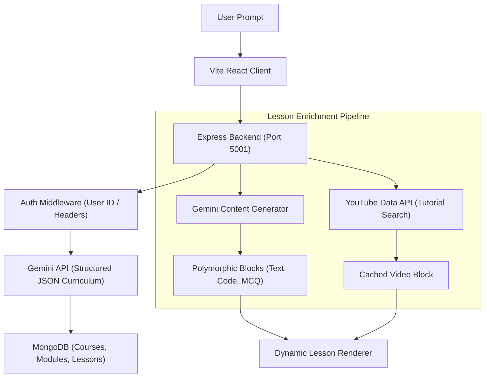

# Text-to-Learn: AI-Powered Course Generator

An automated course generation platform that converts any topic into a multi-module syllabus, complete with rich explanations, code snippets, relevant YouTube tutorials, interactive quizzes, Hinglish audio playback, and PDF export.

---

## Demo Videos
| Part | Content Covered | Link |
|---|---|---|
| **Part 1: Product Walkthrough** | Live Product Walkthrough | [Watch Video on Google Drive](https://drive.google.com/file/d/1XHtS-G3sK78g3IRUfrICnEGOFu19D0MM/view?usp=sharing) |
| **Part 2: Architecture & Code Deep Dive** | Brief walkthrough of codebase and architecture flow | [Watch Video on Google Drive](https://drive.google.com/file/d/1ugDnaifmFLzCqU_cIo1JqtvvsBpsmncn/view?usp=sharing) |
---

## Features

- **Automated Curriculum Generation**: Generates structured modules and lessons from any topic using the Gemini API.
- **Rich Lesson Content**: On-demand enrichment that generates polymorphic lesson blocks (headings, paragraphs, code blocks, video blocks, and quizzes).
- **YouTube Video Integration**: Automatically searches and embeds relevant tutorials with fallback query handling and in-memory caching.
- **Hinglish Audio Player**: Translates technical lessons into conversational Hinglish and plays audio using the browser SpeechSynthesis API.
- **Interactive Quizzes**: Multiple-choice assessment blocks with instant feedback, option indicators, and explanations.
- **PDF Export**: Generates printable multi-page A4 documents using html2canvas-pro and jsPDF with color space normalization.
- **Authentication and Ownership**: Auth0 integration that associates courses with user accounts, supports private course deletion, and provides an open community showcase.

---

## Tech Stack

| Layer | Technologies |
|---|---|
| Frontend | React 19, Vite, Tailwind CSS, Lucide React, React Router 7 |
| Backend | Node.js, Express 5, Mongoose |
| Database | MongoDB |
| AI and APIs | Google Gemini API, YouTube Data API v3, Auth0 |
| Export & Media | html2canvas-pro, jsPDF, Web Speech API |
| CI/CD | GitHub Actions (parallel Ubuntu runners for build and syntax checks) |

---

## Architecture Flow



---

## Environment Variables

### Server (`server/.env`)

```env
PORT=5001
MONGO_URI=mongodb://localhost:27017/course-generator
GEMINI_API_KEY=your_gemini_api_key_here
YOUTUBE_API_KEY=your_youtube_api_key_here
```

### Client (`client/.env`)

```env
VITE_API_URL=http://localhost:5001/api
VITE_AUTH0_DOMAIN=your_auth0_domain_here
VITE_AUTH0_CLIENT_ID=your_auth0_client_id_here
```

---

## Local Development Setup

### Prerequisites
- Node.js (v20 or higher)
- MongoDB running locally or a MongoDB Atlas URI

### 1. Clone the repository
```bash
git clone git@github.com:msck72/ai-course-generator.git
cd ai-course-generator
```

### 2. Configure Backend
```bash
cd server
npm install
# Create .env based on the template above
npm run dev
```
The backend will run on `http://localhost:5001`.

### 3. Configure Frontend
```bash
cd ../client
npm install
# Create .env based on the template above
npm run dev
```
The frontend will run on `http://localhost:5173`.

---

## API Endpoints

| Method | Endpoint | Description |
|---|---|---|
| POST | `/api/courses` | Generates a new course syllabus from a topic prompt |
| GET | `/api/courses` | Lists courses (supports `?filter=mine` query) |
| GET | `/api/courses/:id` | Returns complete course details with modules and lesson IDs |
| DELETE | `/api/courses/:id` | Deletes course and cascades deletion to modules and lessons |
| GET | `/api/lessons/:id` | Fetches single lesson metadata and content blocks |
| POST | `/api/lessons/:id/enrich` | Generates full lesson content blocks and YouTube tutorial |
| POST | `/api/lessons/:id/translate-hinglish` | Translates lesson text into conversational Hinglish |

---

## CI/CD Pipeline

The repository uses GitHub Actions (`.github/workflows/ci.yml`) to automatically validate changes on pull requests targeting `dev` or `main`:

- **Client Job**: Installs dependencies with `npm ci` and verifies production compilation with `npm run build`.
- **Server Job**: Installs dependencies and runs syntax verification with `npm test` (`node --check server.js`).
- **Concurrency Control**: Automatically cancels outdated runs on subsequent pushes to conserve runner resources.